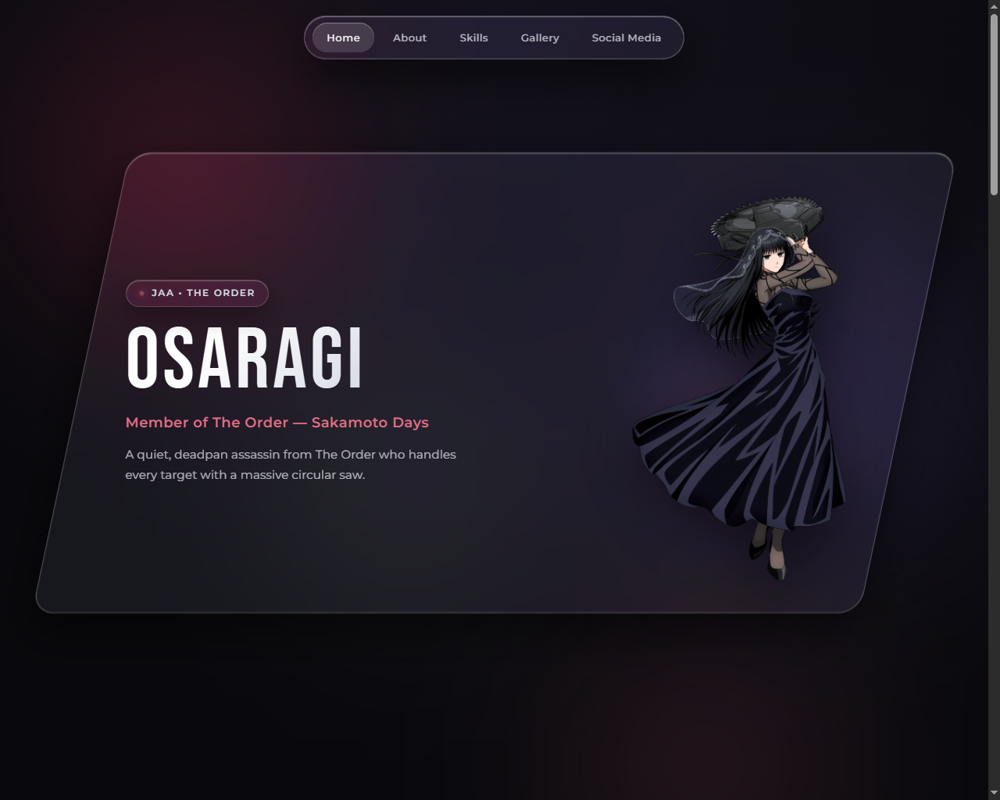
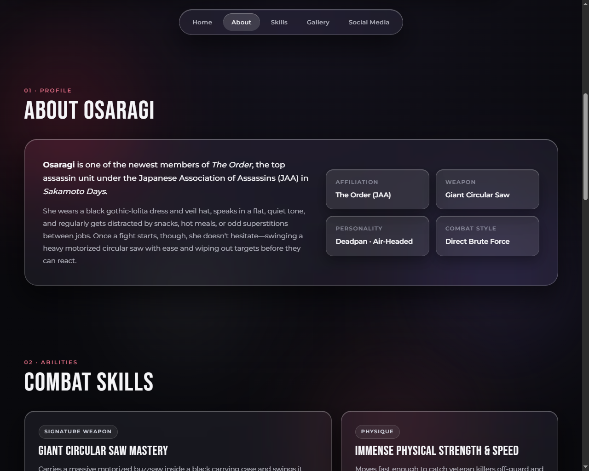
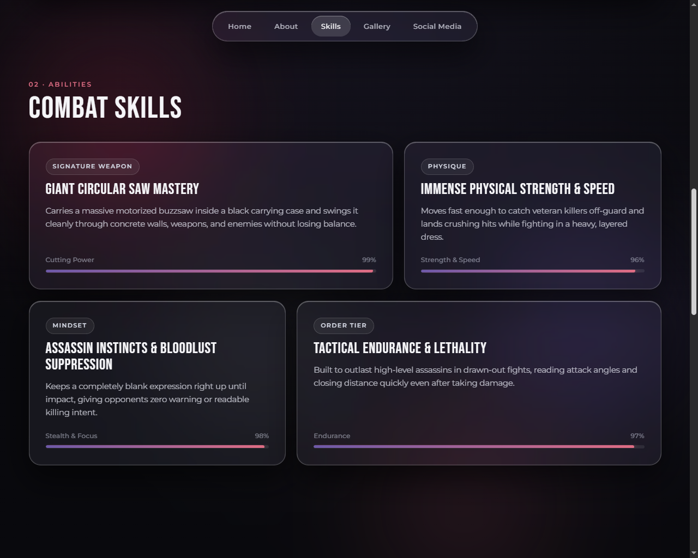
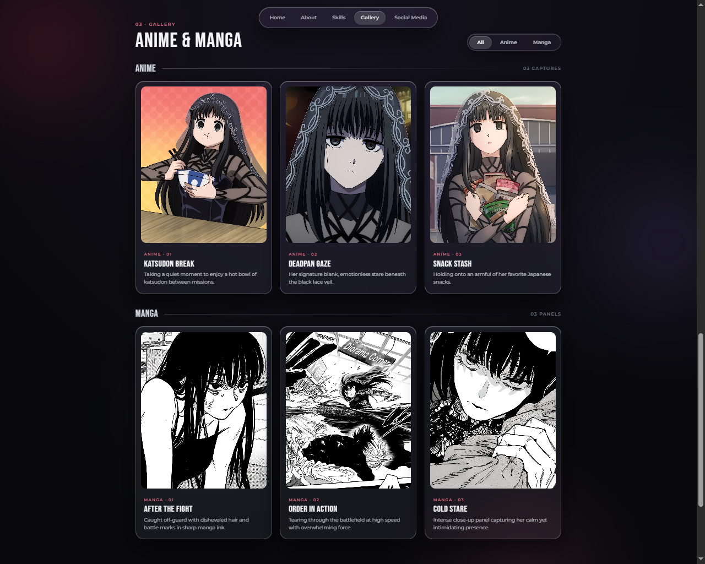

# 🗡️ Osaragi — Character Tribute & Profile Web

A sleek, dark-themed character tribute and profile website dedicated to **Osaragi**, the deadpan powerhouse and member of *The Order* from the hit series **Sakamoto Days**. Designed with a modern card-based aesthetic, subtle ambient gradients, and clean typography to showcase her lore, combat abilities, and iconic anime & manga moments.

---

## 📸 Screenshots

| Hero Section | About Osaragi |
| :---: | :---: |
|  |  |
| **Combat Skills** | **Anime & Manga Gallery** |
|  |  |

---

## ✨ Key Features

- **Atmospheric Dark UI:** Styled with deep charcoal tones, subtle crimson/violet ambient glows, and sleek bordered cards inspired by Osaragi's gothic aesthetic.
- **Floating Pill Navigation:** Clean, top-anchored navigation bar (`Home`, `About`, `Skills`, `Gallery`, `Social Media`) for smooth section browsing.
- **Hero Showcase:** Prominent introduction banner featuring character title, affiliation tagline, and character render.
- **Character Profile & Dossier:** Dedicated biography section paired with structured stat badges (*Affiliation*, *Weapon*, *Personality*, and *Combat Style*).
- **Combat Skills Breakdown:** Interactive-style ability cards complete with proficiency/stat progress bars (*Giant Circular Saw Mastery*, *Immense Physical Strength & Speed*, *Assassin Instincts & Bloodlust Suppression*, and *Tactical Endurance & Lethality*).
- **Anime & Manga Gallery:** Organized dual-row media showcase highlighting both colored anime scenes and monochrome manga panels.

---

## 🛠️ Tech Stack

- **HTML5** — Semantic page structure and content layout
- **CSS3** — Custom dark-mode styling, flexbox/grid layouts, gradients, and visual polish
- **JavaScript** *(Optional / Placeholder)* — Ready for future enhancements such as smooth scrolling, lightbox image previews, or theme interactions

---

## 🤝 Credits & Connect

- **Creator / Developer:** [manyagami](https://github.com/manyagami)
- **GitHub:** [manyagami](https://github.com/manyagami)
- **Instagram:** [@mandarwishhhh](https://instagram.com/mandarwishhhh)
- **TikTok:** [@surrenderbythem](https://tiktok.com/@surrenderbythem)
- **Email:** [mandarwish017@gmail.com](mailto:mandarwish017@gmail.com)

---

## ⚠️ Disclaimer

This is a non-commercial, fan-made tribute project created for educational and portfolio purposes only. **Osaragi** and **Sakamoto Days** (including all related characters, anime stills, manga panels, and artwork) are the intellectual property of **Yuto Suzuki**, **Shueisha**, and the respective anime production studios. All rights belong to their original owners.
